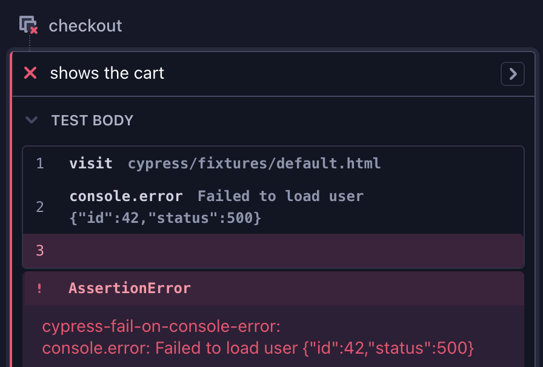
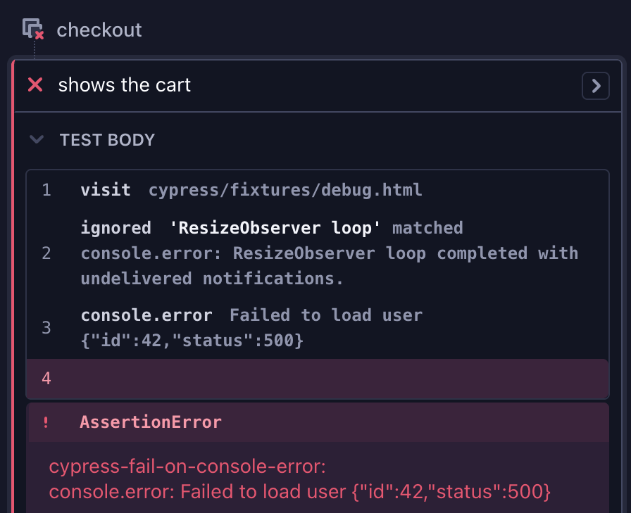

# cypress-fail-on-console-error

[](https://www.npmjs.com/package/cypress-fail-on-console-error)
[](https://github.com/nils-hoyer/cypress-fail-on-console-error/actions/workflows/ci.yml)

Fail Cypress tests when the application under test calls `console.error()`. Works for e2e and component tests.

To fail tests on network errors, see [cypress-fail-on-network-error](https://www.npmjs.com/package/cypress-fail-on-network-error).

## Installation

```sh
npm install cypress-fail-on-console-error --save-dev
```

Requires Cypress 14 or later.

## Usage

Call `failOnConsoleError()` in your support file: `cypress/support/e2e.js` for e2e tests, `cypress/support/component.js` for component tests, or the `.ts` versions of these files.

```js
import failOnConsoleError from 'cypress-fail-on-console-error';

failOnConsoleError();
```

When the application calls `console.error()`, the test fails after the current command:



## Config (optional)

| Option                  | Default     | Description |
| ----------------------- | ----------- | ----------- |
| `ignoreConsoleMessages` | `[]`        | Console messages that don't fail a test, as `string`, `RegExp` or `{ type, message }` to ignore a message for one console method only. Strings are converted with `new RegExp(string)`, so [escape special characters](https://javascript.info/regexp-escaping). |
| `consoleTypes`          | `['error']` | Console methods that fail a test: `error`, `warn`, `info`, `debug`, `trace`, `table`, `log` or `assert`. |
| `debug`                 | `false`     | Shows which console messages your `ignoreConsoleMessages` ignore. Each ignored message is logged to the command log with the entry that matched it. Without `debug`, only messages that fail the test are logged. See [Debugging](#debugging). |

```ts
import failOnConsoleError, { Config } from 'cypress-fail-on-console-error';

const config: Config = {
    ignoreConsoleMessages: [
        'ResizeObserver loop',
        /unique "key" prop/,
        { type: 'warn', message: /is deprecated/ }, // only for console.warn
    ],
    consoleTypes: ['error', 'warn'],
};

failOnConsoleError(config);
```

To fail only on messages that contain some text, ignore every message that doesn't contain it:

```ts
failOnConsoleError({
    // ignore every message that doesn't contain React
    ignoreConsoleMessages: [/^(?![\s\S]*React)/],
});
```

### How messages are matched

- All arguments of a console call are joined with spaces into one message, and non-string arguments are converted with `JSON.stringify`. For example, `console.error('failed', 1, { foo: 'bar' })` becomes `failed 1 {"foo":"bar"}`.
- Format specifiers in the first argument are filled in as the browser console does, and `%c` styles are dropped. For example, `console.error('Warning: %s is deprecated', 'componentWillMount')` becomes `Warning: componentWillMount is deprecated`.
- An `Error` argument becomes its name, message and stack trace. For example, `console.error(new TypeError('user is undefined'))` becomes `TypeError: user is undefined` followed by lines like `at render (app.js:12:5)`, so you can also match the file an error came from.

## Change the config in a test

To change the ignored messages in a test, register the commands in your support file:

```ts
import failOnConsoleError, {
    addIgnoredConsoleMessagesCommands,
} from 'cypress-fail-on-console-error';

const failOnConsole = failOnConsoleError(config);
addIgnoredConsoleMessagesCommands(failOnConsole);
```

Then use them in a test. Changes last until the end of the test.

```ts
it('should ignore console messages that contain foo or bar', () => {
    cy.addIgnoredConsoleMessages(['foo', /bar/]);
    cy.visit('...');
});
```

| Command                                           | Description |
| ------------------------------------------------- | ----------- |
| `cy.getIgnoredConsoleMessages()`                  | Yields `ignoreConsoleMessages`. |
| `cy.setIgnoredConsoleMessages(['foo', /bar/])`    | Replaces `ignoreConsoleMessages`. |
| `cy.addIgnoredConsoleMessages(['foo', /bar/])`    | Adds to `ignoreConsoleMessages`. |
| `cy.deleteIgnoredConsoleMessages(['foo', /bar/])` | Removes from `ignoreConsoleMessages`. |

To change other options, use `getConfig()` and `setConfig()`, which `failOnConsoleError()` returns:

```ts
const { getConfig, setConfig } = failOnConsoleError(config);

Cypress.Commands.add('setConsoleTypes', (consoleTypes) =>
    setConfig({ ...getConfig(), consoleTypes })
);
```

## Debugging

Click a `console.error` entry in the command log to print the original arguments and the message your `ignoreConsoleMessages` were matched against to the browser console.

Set `debug: true` to also log each ignored message, with the entry of `ignoreConsoleMessages` that matched it:

```ts
failOnConsoleError({
    ignoreConsoleMessages: ['ResizeObserver loop'],
    debug: true,
});
```



## Upgrading from 5.x to 6.0

- Cypress 14 or later is required.
- `consoleMessages` was renamed to `ignoreConsoleMessages`, and the old name now throws. Replace it in your config and in `setConfig()` calls, and replace `getConfig().consoleMessages` with `getConfig().ignoreConsoleMessages`.
- Unknown options throw, so a typo like `consoleType` no longer goes unnoticed.
- Format specifiers like `%s` are filled in before matching (see [How messages are matched](#how-messages-are-matched)). A pattern written against the old message, such as `'Warning: %s is deprecated componentWillMount'`, must become `'Warning: componentWillMount is deprecated'`. The CSS arguments of `%c` are no longer part of the message.
- An empty `RegExp` (`new RegExp('')` or `/(?:)/`) throws, like `''` already did. It ignored every message.
- Import from `cypress-fail-on-console-error` only. Imports from paths inside the package, such as `cypress-fail-on-console-error/dist/index`, fail, and internal helpers like `validateConfig` are no longer exported.
- The plugin no longer depends on `chai`, `sinon`, `sinon-chai` and `type-detect`. If your project imports one of them, add it to your own `devDependencies`.
- The plugin no longer calls `chai.should()`. If your tests use chai's `should` style on plain values (`value.should.equal(1)`, not `cy.should()`), call `chai.should()` in your support file.
- Failures are still shown as `AssertionError`, but are no longer instances of chai's `AssertionError` class.

## Contributing

1. Open an issue that describes the problem and the expected behaviour.
2. Install dependencies with `npm ci`. The e2e and component tests run Cypress in Chrome, so Chrome must be installed.
3. Make your change in `src/` (`index.ts` for the public API, `internal.ts` for the helpers behind it) and run `npm run build`. The tests run against `dist/`, which is committed.
4. Run `npm run verify` (build, type check, format check, unit, e2e and component tests). It must pass.
5. Open a PR with the implementation and tests. Don't change the version in `package.json`: the maintainer releases from GitHub Actions, which increases the version.
